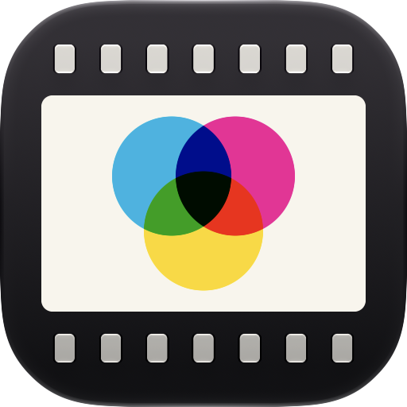
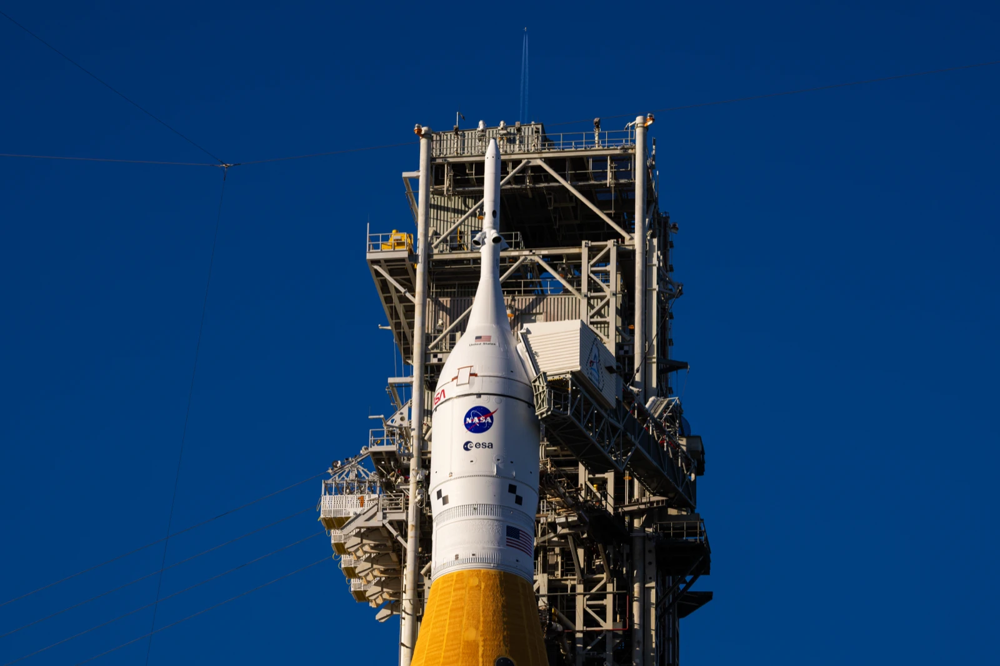
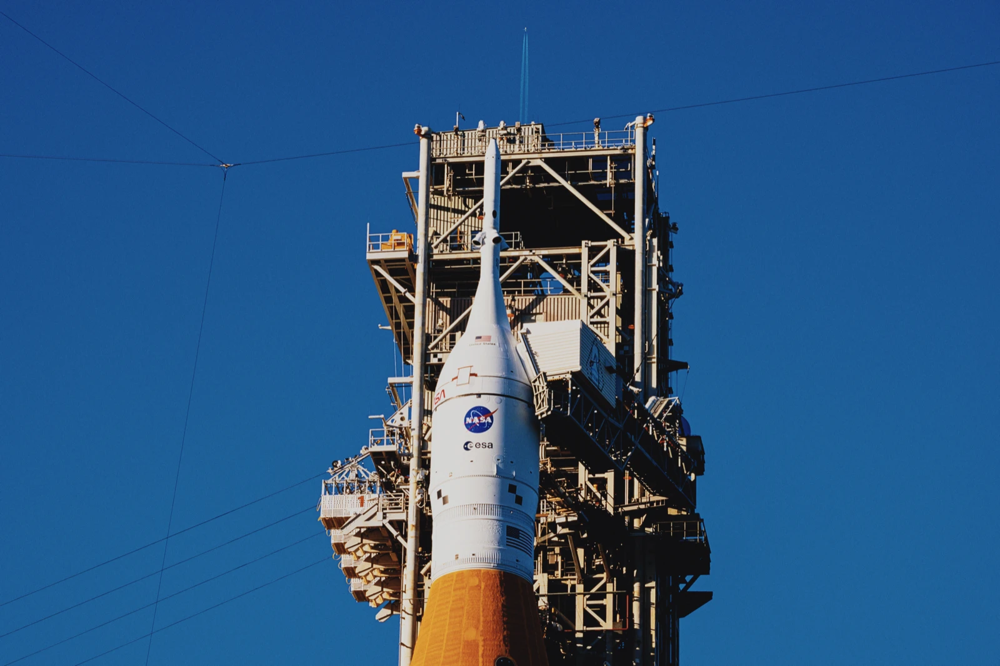
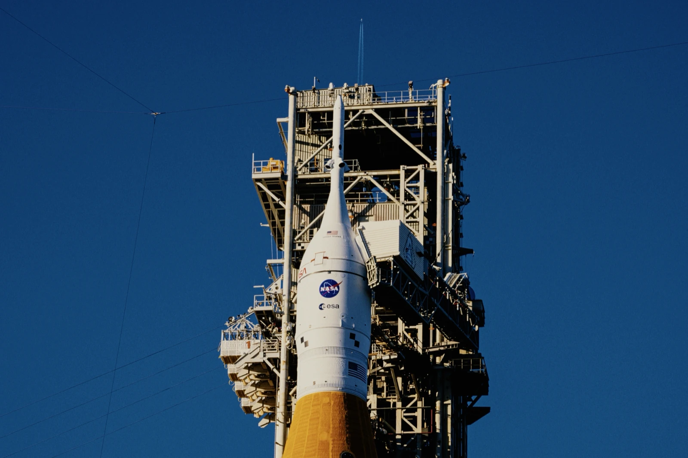

<p align="center">
  
</p>

<h1 align="center">SpektraMac</h1>

<p align="center">
  <b>Physically based analog film for your photos, on your Mac's GPU.</b><br>
  A native macOS port of <a href="https://github.com/andreavolpato/spektrafilm">Spektrafilm</a>: choose a film and a
  paper, and see your photo exposed, developed, printed and scanned, from the film's own spectral data.
</p>

<p align="center">
  <a href="https://github.com/nainajnahO/SpektraMac/actions/workflows/build.yml"></a>
  <a href="https://github.com/nainajnahO/SpektraMac/releases/latest"></a>
  
  
  
  <a href="LICENSE"></a>
</p>

<p align="center">
  <a href="docs/guide.md">User guide</a> ·
  <a href="https://github.com/nainajnahO/SpektraMac/releases">Releases</a> ·
  <a href="#build-from-source">Build from source</a> ·
  <a href="ACCESSIBILITY.md">Accessibility</a>
</p>


## Film looks

Each render is the whole simulation: the film's exposure and development, a print on paper (or, for a slide, the
film itself) and its scan.

<table>
  <tr>
    <td align="center"><br>Original</td>
    <td align="center"><br>Kodak Portra 400</td>
    <td align="center"><br>Fujifilm Velvia 100</td>
  </tr>
  <tr>
    <td align="center"><br>Kodachrome 64</td>
    <td align="center"><br>Kodak Ektar 100</td>
    <td align="center"><br>Kodak Vision3 500T</td>
  </tr>
</table>

## Features

- **20 films, 8 papers.** Colour negatives (Portra, Ektar, Gold, Ultramax, Fujifilm Pro 400H, C200, X-Tra), slides
  (Velvia, Provia, Ektachrome, Kodachrome) and motion picture film (Vision3 50D to 500T), printed on Kodak and Fujifilm
  papers or Kodak's cinema print films, or viewed as film.
- **The camera.** Exposure metered on the whole frame, or on the faces, people or objects it finds, and remembered
  from photo to photo; highlight recovery; diffusion filters (Glimmerglass, Black Pro-Mist, Pro-Mist, CineBloom).
- **The film.** Halation and light scattering in the emulsion, the DIR couplers behind film's saturation and edge
  contrast, and grain from silver halide particles.
- **The print.** Enlarger exposure and colour filters, preflash, paper contrast, a darkroom burn for bright skies,
  a diffusion filter on the enlarger and glare, with the print's tone curve on a graph you can drag.
- **Live.** A preview in about 20 ms while you drag, and the full look when you let go. Point at a film or paper in
  its menu to see it on the photo, or click the photo to compare it with the original.
- **Your files.** Opens camera RAW (developed linearly, as Spektrafilm does), HEIC, JPEG, TIFF and PNG. Saves JPEG,
  or 16-bit TIFF and PNG, in Display P3, keeping the camera's metadata and recording the edit in the file.
- **Reuse.** Presets, defaults for each film, and 3D LUT export (`.cube`, sRGB) for other apps.

<table>
  <tr>
    <td width="50%"><br>
      <b>Metering.</b> Apple's Vision finds the faces, people and objects in a photo, and each gets a mark on the
      Exposure strip. Hold the strip to see what a mark meters.</td>
    <td width="50%"><br>
      <b>Burn.</b> Extra print exposure where the photo is bright, as a darkroom printer burns in a sky. Hold a Burn
      slider to see what burns.</td>
  </tr>
</table>

The [user guide](docs/guide.md) explains every film, paper and control.

## Speed

The whole simulation, grain and halation included, runs on the GPU. On a MacBook Pro with an M1 Pro and 16 GB of
memory, against the Python Spektrafilm it ports, on the same photo:

| | Python Spektrafilm | SpektraMac | |
|---|---|---|---|
| Full render, 2400 × 1600 | 18.5 s | 70 ms | about 260× faster |
| Preview, 1600 × 1067 | 4.1 s | 20 ms | about 200× faster |
| Full render, 6000 × 4000 (24 MP) | stopped after 10 minutes, using over 33 GB | 0.41 s | |
| Full render, 6960 × 4640 (32 MP) | | 0.58 s | |

Kodak Portra 400 printed on Kodak Portra Endura with grain, halation, couplers and glare; the previews in preview
mode (no grain or blurs) on both; the best of several runs. To time SpektraMac on your own photo:

```sh
swift run -c release --package-path Engine spektra-cli benchmark photo.jpg
```

## Faithful to Spektrafilm

The results match the Python reference stage by stage. The reference is Spektrafilm's `main` at commit
[`3bb2c2d`](https://github.com/andreavolpato/spektrafilm/commit/3bb2c2d2801ff68b92019cf1dbcbb133d60832bc) (June
2026), which has no release of its own. The tests compare every step of the pipeline with dumps from the Python code:
negatives, slides and motion picture film, on a test chart and on a photo. Where the Mac takes a faster route, such as
Apple's blurs, the difference is measured and kept small.

To install the same Spektrafilm:

```sh
uv tool install "spektrafilm @ git+https://github.com/andreavolpato/spektrafilm@3bb2c2d2801ff68b92019cf1dbcbb133d60832bc"
```

## Build from source

There's no download yet. You need macOS 26.5 or newer and [Xcode 27](https://developer.apple.com/xcode/).

1. Clone the repository and open the project:

   ```sh
   git clone https://github.com/nainajnahO/SpektraMac.git
   open SpektraMac/SpektraMac.xcodeproj
   ```

2. In the SpektraMac target's **Signing & Capabilities**, choose your own team, or **Sign to Run Locally**.
3. Choose **Product › Run** (⌘R).

## Development

| Path | What |
|---|---|
| `App/` | SwiftUI app |
| `Engine/` | `SpektraEngine` Swift package (Metal shaders, host code, tests) and the `spektra-cli` tool |
| `Engine/Sources/SpektraEngine/Resources/` | Film and paper profiles and spectral tables exported from Spektrafilm |
| `docs/` | User guide |

To run the tests or send a change, see [CONTRIBUTING.md](CONTRIBUTING.md). See the
[releases](https://github.com/nainajnahO/SpektraMac/releases) for what's changed and the
[issues](https://github.com/nainajnahO/SpektraMac/issues) for what's next.

## Credits and licence

All of the photographic model, film and paper data and the methods come from
[Spektrafilm](https://github.com/andreavolpato/spektrafilm) by Andrea Volpato. This port is a derivative work and is
licensed under the GNU GPL v3 (see [LICENSE](LICENSE)). The film and paper profile data are licensed by their author
under CC BY-SA 4.0.

The [spektrafilm-rs](https://github.com/turbasvin/spektrafilm-rs) Rust port was used as a reference for structuring
the GPU stages.

Photo, in the public domain:
[Artemis II at Launch Pad 39B](https://commons.wikimedia.org/wiki/File:Sun_sets_on_Full_Artemis_II_Stack_at_Launch_Pad_39B_(Artemis_II_at_the_pad_sunsetting_jet_in_background_01292026_9).jpg)
by NASA/Sam Lott.
