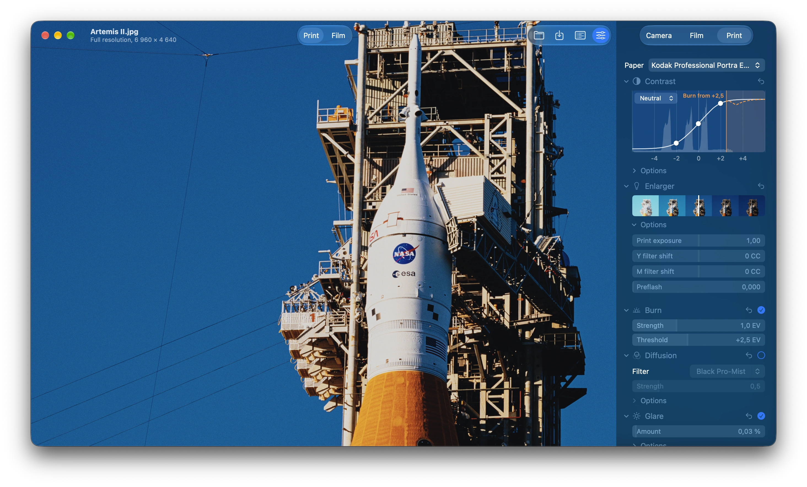
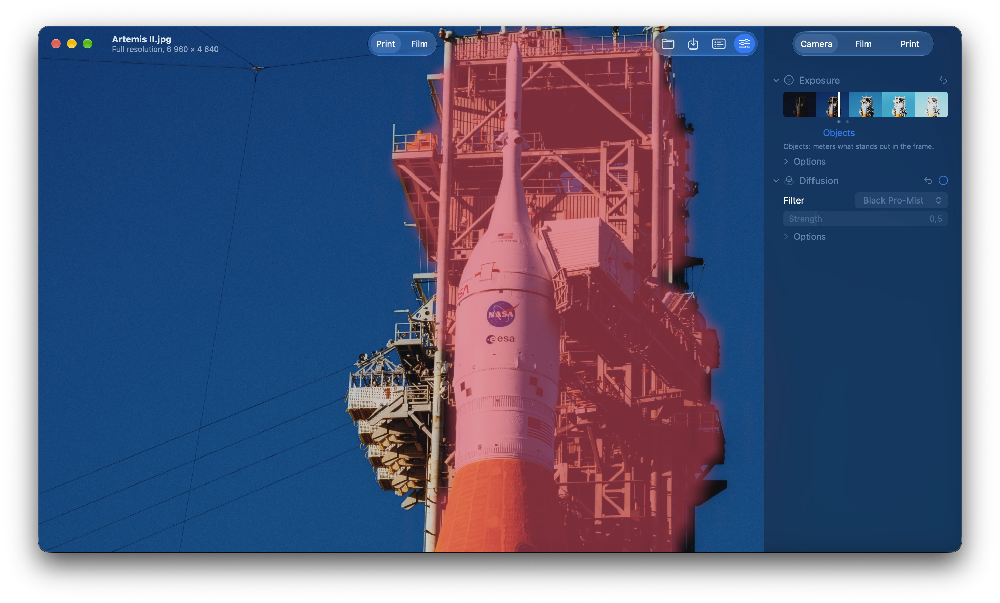
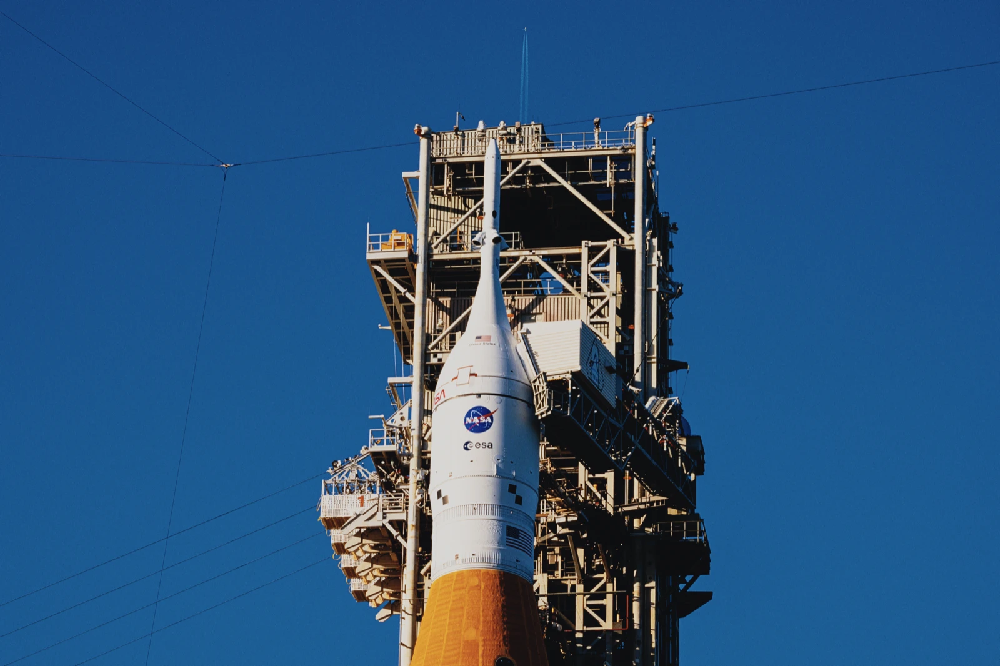
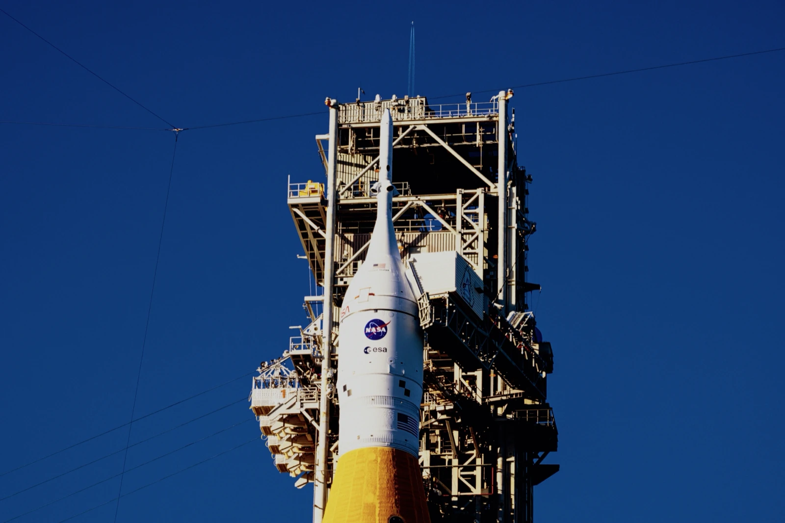
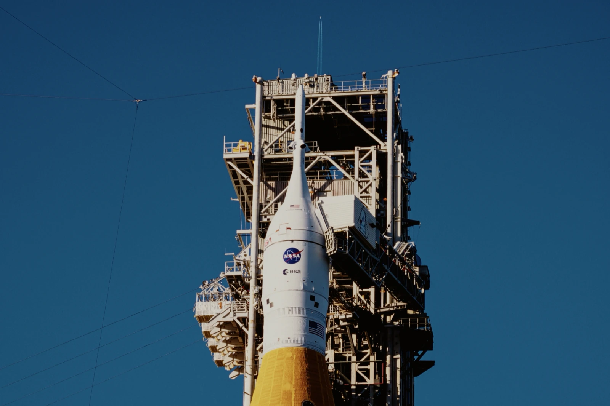
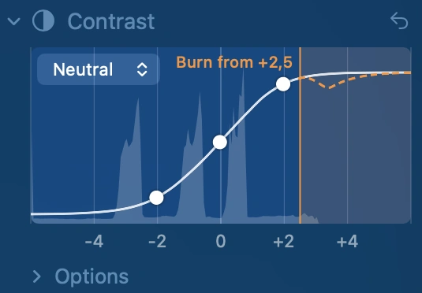
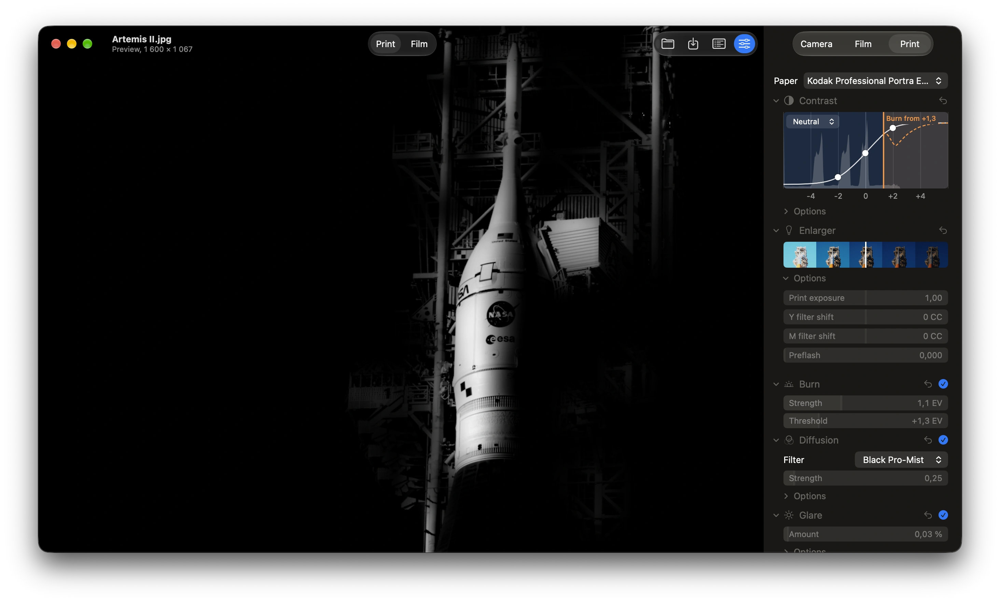

# SpektraMac user guide

SpektraMac simulates colour film the way it happens in a darkroom. Your photo is the light that reaches the
film in the camera; the film is exposed and developed into a negative (or a slide); the negative is printed on
paper with an enlarger; and the print is scanned for your screen. Each step uses the film's and the paper's own
measured data, from [Spektrafilm](https://github.com/andreavolpato/spektrafilm), so the colours, contrast, grain and
glow come from how those materials behave rather than from a filter.

- [Getting started](#getting-started)
- [The window](#the-window)
- [Camera](#camera)
- [Film](#film)
- [Print](#print)
- [Saving](#saving)
- [Presets and film defaults](#presets-and-film-defaults)
- [Exporting a LUT](#exporting-a-lut)
- [Keyboard shortcuts](#keyboard-shortcuts)
- [Films and papers](#films-and-papers)

## Getting started

1. Open a photo with **File › Open…** (⌘O), the **Open…** button, or by dropping it on the window. SpektraMac opens
   anything your Mac can: camera RAW, HEIC, JPEG, TIFF, PNG and more, up to 16,384 pixels on a side (the most the
   graphics processor takes). A larger photo, such as a stitched panorama, is refused with a message saying so.
2. Choose a film in the **Film** tab, and a paper in the **Print** tab.
3. Adjust what you like, then **File › Save…** (⌘S).

A RAW file is developed linearly, as Spektrafilm does: no added contrast, curve or tone mapping, and the camera's
white balance, so the film gets the light the sensor recorded. A new photo opens with the same settings as the last
one, exposed the same way (see [Exposure](#exposure)).

## The window

**The photo.** It fits the window to start with.

- **Zoom:** scroll, or pinch on a trackpad, to zoom around the pointer, up to 4 screen points per pixel. Zoomed in,
  SpektraMac renders the photo at full resolution.
- **Move:** drag the photo.
- **Compare:** click the photo to see the original in its place, at the same zoom, and click again to see the film.
  While the original shows, the window's subtitle reads "Original" and the settings are greyed out. The original is
  the photo as macOS shows it, as in Preview.
- **Fit:** double-click to fit the photo again.

**Show: Print | Film** (the centre of the toolbar).

- **Print** shows the negative printed on the paper: the finished photo.
- **Film** shows the developed film itself, as a scanner sees it: the orange negative, or a slide. A slide can only
  be shown as film, because the papers are made for negatives.

**The settings** are on the right. Show or hide them with the **Adjust** button. They're in three tabs that follow
the light: **Camera**, **Film** and **Print**.

- **Groups:** each tab is made of groups. Click a group's title to fold it.
- **Reset:** ↩ returns the group to the film's defaults.
- **On and off:** effects that can be turned off have a circle; a check means on.
- **Options:** the rarer settings are under **Options**.

**Sliders.** A slider shows its name and value. Drag anywhere along it to change the value: the drag moves the value
from where it is, and the slider's whole width covers its whole range. The filled part runs from the neutral value.
With Full Keyboard Access, ← and → step the value.

**Strips.** Some settings are a strip of small frames of your photo across the setting's range. Click or drag on the
strip to set the value where you point. The white line marks the current value.

**Menus.** In the Film, Paper and diffusion filter menus, the photo shows whichever item the pointer is on, so you can
look through films before choosing one. Closing the menu without choosing puts the photo back.

**Speed.** While you drag a slider, the photo shows a quick preview without grain or blurs (about 20 ms on an M1
Pro). When you let go, the finished look renders at the size of the window. Renders already made come back at once,
for example when a slider returns to an earlier value.

**Status and Log.** The window's subtitle says what SpektraMac is doing, and the photo's size when it's idle. The
**Log** button opens a window listing what was opened, rendered and saved, with timings, and any errors.

## Camera

### Exposure

How much light reaches the film, in stops (EV). The strip shows the photo from 4 stops under to 8 stops over the
exposure as shot.

The dots under the strip are **metering marks**: the exposure each way of metering gives this photo. Drag onto a dot
and it snaps there; its name shows under it, and the trackpad clicks. While you drag the strip, the area the
nearest mark meters is tinted pink. Apple's Vision finds the faces, people and objects when the photo opens.

| Mark | Meters |
|---|---|
| As shot | The exposure the camera chose. |
| Centre-weighted | The whole frame, the centre counting most, as Spektrafilm and a film camera do. The default. |
| Objects | What stands out in the frame. |
| People | The people in the frame, so a bright sky or background can't darken them. |
| Faces | The faces in the frame. |

SpektraMac remembers the mark and how far you are from it, not the exposure itself. Set +0.3 EV from Faces, and the
next photo opens 0.3 stops over its own faces' reading. If a photo has no faces (or no people, or nothing that stands
out), the mark falls back, from Faces to People, People to Objects and Objects to Centre-weighted, and the line
under the strip says so.

**Options:**

- **Exposure** sets the same value with a slider, as an offset from the mark.
- **Highlight boost** (0–10 EV, off at 0) raises the brightest highlights before they reach the film, rebuilding
  light the camera clipped, so bright lights glow more.

### Lens diffusion

A diffusion filter on the camera's lens. It scatters some of the scene's light before it reaches the film, so bright
areas glow into the darker ones around them, as in the halos around lamps. Off by default.

- **Filter:**
  - **Glimmerglass** keeps detail and glows faintly.
  - **Black Pro-Mist** gives a tight, punchy halo.
  - **Pro-Mist** gives a broader pastel haze.
  - **CineBloom** gives a wide glow that lifts the whole frame.
- **Strength:** the filter's grade, as filters are sold, from 1/8 to 2. Stronger spreads more light into the glow.
- **Options:**
  - **Size** sets how far the glow reaches, as a multiple of the filter's own.
  - **Warmth** makes the glow warmer at its rim and cooler at its centre, or the reverse below 0.

## Film

### Film

The film stock (see [Films and papers](#films-and-papers)). Choosing a film also does the following:

- **Paper:** switches to the paper the film is made for, if it has one.
- **Show:** switches to **Film** for a slide, and to **Print** for a negative.
- **Saved defaults:** if you've saved defaults for the film (see
  [Presets and film defaults](#presets-and-film-defaults)), every setting becomes those defaults.

Otherwise the settings stay as they are.

<table>
  <tr>
    <td align="center"> Kodak Portra 400</td>
    <td align="center"> Fujifilm Velvia 100</td>
    <td align="center"> Kodachrome 64</td>
  </tr>
</table>

### Halation

A red glow around bright lights. Light passes through the film, bounces off its base and comes back into the
emulsion. How much depends on the film's antihalation layer, which absorbs most of it: strong in films such as
Portra, weaker in films such as Gold 200. On by default.

- **Strength:** the glow, as a multiple of the film's own.
- **Options:**
  - **Size:** how far the glow reaches.
  - **Scatter:** light spreading inside the emulsion, which softens fine detail.
  - **Scatter size:** how far that light spreads.

### Couplers

In colour film, chemicals released as each colour layer develops hold back development, in the other layers and
nearby in the same one. This gives film its colour separation and the crisp edges in fine detail. On by default.

- **Saturation** (strip, 0–1.5): how strongly each layer holds back the others. More gives purer colours.
- **Options:**
  - **Saturation:** the same, as a slider.
  - **Edge contrast** (0–1.5): how strongly each layer holds back its own development nearby. More gives crisper
    edges in fine detail. The overall contrast stays the film's.

### Grain

Grain from the film's silver halide particles. On by default.

- **Size:** the area of one particle, in µm². About 0.1 µm² is like ISO 100 film, and 0.4 µm² like ISO 400.
- **Options:**
  - **Softness:** a blur over the grain, in pixels of the render.

## Print

The Print tab applies when the toolbar shows **Print**. With **Film** showing, it's greyed out, with a note why.

### Paper

The paper the negative is printed on, or a print film for motion picture negatives (see
[Films and papers](#films-and-papers)).

### Contrast

The **tone graph** shows how the photo's tones print.

- **Histogram:** across the bottom, how much of the photo is at each tone, from 6 stops under mid-grey to 6 over.
- **Curve:** how bright each tone prints, from the film through the paper.
- **Curve menu:** shows the neutral curve, or each colour's with the other two faint.

Drag on the graph to change the print:

- **The middle point, sideways:** the print exposure. Right gives a darker print, left a lighter one.
- **The side points, up or down:** the contrast of the shadows and of the highlights.
- **The curve anywhere else, up or down:** the overall contrast, turning about the middle point.

**Options:**

- **Contrast** (0.1–3): the paper's contrast around mid-grey. Lower brings a bright sky and dark faces closer.
- **Highlight contrast:** the light tones alone. Lower keeps more detail in a bright sky.
- **Shadow contrast:** the dark tones alone. Lower opens up faces in shadow.

### Enlarger

- **Print exposure** (strip, 0–2): the enlarger's exposure time, relative to the one that prints a mid-grey neutral.
  More is darker, as on paper.
- **Options:**
  - **Y filter shift** and **M filter shift** (−100 to 100 CC): the enlarger's yellow and magenta filters, in Kodak
    colour-correction units, away from the neutral filtration for this film and paper.
  - **Preflash** (0–0.05): a flash of plain light on the paper before the print, so light tones such as a bright sky
    gain some tone. It darkens the whole print, so lower the print exposure to bring the mid-tones back.

### Burn

A darkroom burn: extra print exposure where the photo is bright. A pale sky darkens and gets its colour back, and the
rest of the print stays as it is. Off by default. The burn follows the photo's edges.

- **Strength** (0–3 EV): how much extra exposure.
- **Threshold** (0 to +6 EV): how bright a part of the photo must be to burn, in stops over mid-grey. About +2.5 is
  where a screen's white sits; lower takes in more.

While you hold a Burn slider, the photo shows what burns, white on black.

On the tone graph, orange shading marks the tones that burn, and a dashed line shows where they print. Drag the line
sideways for the threshold, or up and down for the strength.

### Enlarger diffusion

A diffusion filter on the enlarger's lens, over the print. It scatters the light after it has passed through the
negative, and most of that light comes through the parts that print dark. So the print's dark areas spread softly into
the lighter ones around them, instead of bright areas glowing as with [Lens diffusion](#lens-diffusion). It has the
same filters and settings. Off by default.

### Glare

Stray light over the print as you look at it, which lifts the blacks a little, as on a real print. On by default.

- **Amount:** the stray light, in percent of the light.
- **Options:**
  - **Roughness:** how unevenly it falls.
  - **Softness:** a blur over it, in pixels of the render.

## Saving

**File › Save…** (⌘S) renders the photo at full resolution with every effect and saves it. The file's extension
picks the format:

| Format | Bits per channel | Notes |
|---|---|---|
| JPEG | 8 | Quality 98% |
| TIFF | 16 | Uncompressed |
| PNG | 16 | |

Saved photos are in Display P3, with its colour profile. While it saves, the window's subtitle shows the progress,
and **Cancel** (⌘.) stops it.

Saving keeps the original's metadata: its EXIF, GPS and IPTC, and the camera's make, model, date, artist and
copyright. It also records the edit:

- **Software:** SpektraMac and its version.
- **Description:** a line such as "Kodak Portra 400 printed on Kodak Professional Portra Endura · +0.3 EV · halation ·
  couplers · grain · glare".
- **Keywords:** the film, the paper and SpektraMac, after the photo's own.
- **XMP:** every setting, under `spektramac:`.

## Presets and film defaults

The **Preset** menu keeps settings for later.

- **Save Preset…** (⇧⌘S) saves every setting, film and paper included, as a small `.json` file.
- **Open Preset…** (⇧⌘O) applies one.
- **Make Default for** *film* keeps the current settings for that film. Choosing the film again applies them, and
  the groups' ↩ buttons return to them.
- **Restore Factory Defaults** forgets them and sets everything back to SpektraMac's defaults.

## Exporting a LUT

**File › Export LUT…** (⇧⌘E) saves the current film, paper and settings as a 3D LUT, for apps that apply LUTs to
video or photos. It's a `.cube` file (33 × 33 × 33), with sRGB in and out. A photo doesn't need to be open.

A LUT changes each colour on its own, so it can't hold what depends on neighbouring pixels or on the whole photo.
These are left out:

- grain, halation and glare;
- the burn and highlight boost;
- the diffusion filters;
- the crisper edges of the couplers' Edge contrast.

The exposure is the Exposure slider's offset.

## Keyboard shortcuts

| Command | Shortcut |
|---|---|
| Open | ⌘O |
| Save | ⌘S |
| Export LUT | ⇧⌘E |
| Cancel saving | ⌘. |
| Open Preset | ⇧⌘O |
| Save Preset | ⇧⌘S |

## Films and papers

The menus group the films and papers by kind.

**Negatives** (printed on paper)

| Film | Paper it's made for |
|---|---|
| Fujifilm C200 | Fujifilm Crystal Archive Type II |
| Fujifilm Pro 400H | Fujifilm Crystal Archive Type II |
| Fujifilm X-Tra 400 | Fujifilm Crystal Archive Type II |
| Kodak Ektar 100 | Kodak Professional Portra Endura |
| Kodak Gold 200 | Kodak Professional Portra Endura |
| Kodak Portra 160 | Kodak Professional Portra Endura |
| Kodak Portra 400 (the default) | Kodak Professional Portra Endura |
| Kodak Portra 800, and pushed one and two stops | Kodak Professional Portra Endura |
| Kodak Ultramax 400 | Kodak Professional Portra Endura |

**Slides** (viewed directly): Fujifilm Provia 100F, Fujifilm Velvia 100, Kodak Ektachrome 100, Kodak Kodachrome 64.

**Motion picture negatives** (printed on Kodak Vision 2383): Kodak Vision3 50D, 200T, 250D and 500T, and Kodak
Verita 200D. D films are balanced for daylight, and T films for tungsten light.

**Papers:** Fujifilm Crystal Archive Type II, Kodak Ektacolor Edge, Kodak Professional Endura Premier, Portra Endura,
Supra Endura and Ultra Endura.

**Print films** (for motion picture negatives): Kodak Vision 2383 and Kodak Vision Premier 2393.

The film and paper data are by Andrea Volpato, from Spektrafilm, under CC BY-SA 4.0.
