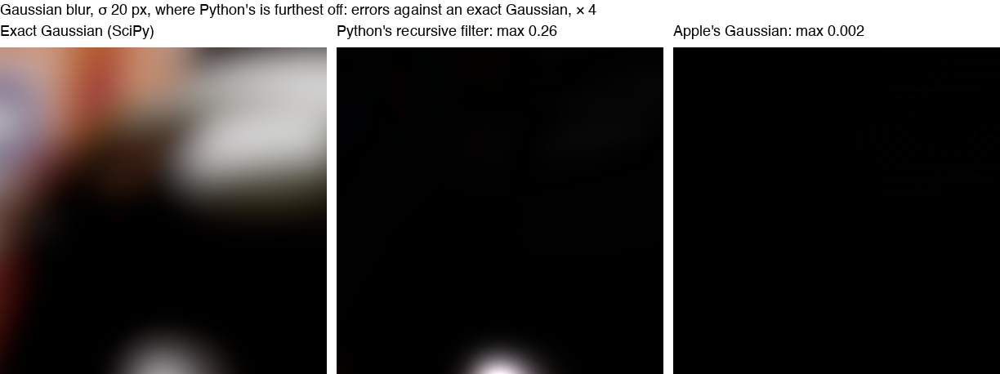
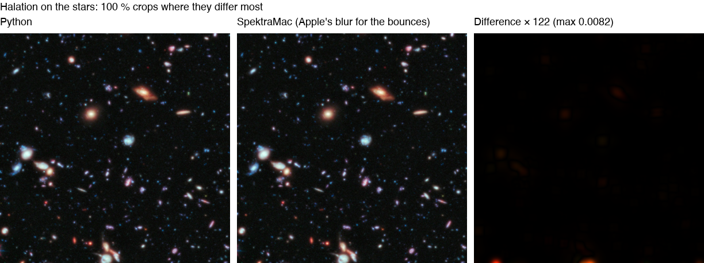
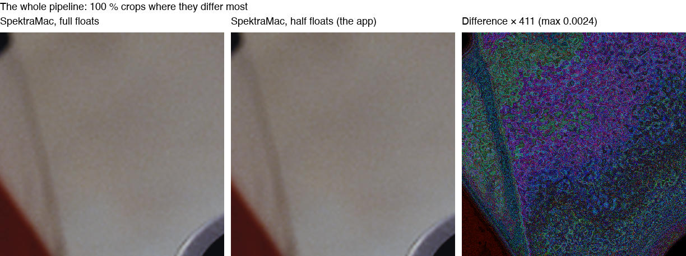
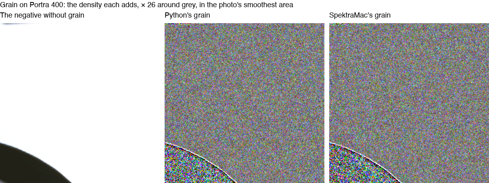
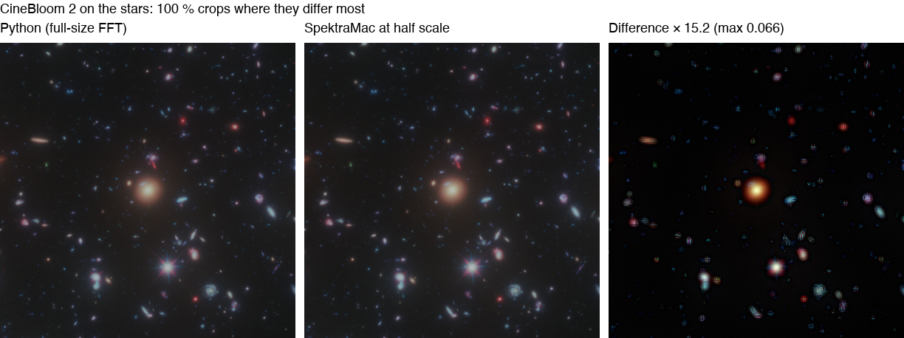
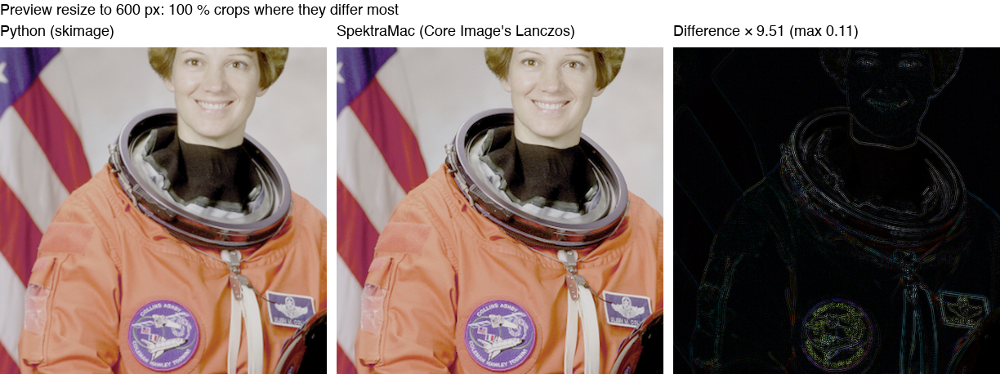

# How SpektraMac ports Spektrafilm

SpektraMac follows [Spektrafilm](https://github.com/andreavolpato/spektrafilm)'s model, not its code. Each step
computes what Spektrafilm's does, and an Apple framework does the work wherever one can
([CONTRIBUTING: Native first](../CONTRIBUTING.md#native-first)). The parity tests hold every stage to Spektrafilm at
commit `3bb2c2d` on small reference cases. This page goes further: it measures each ported step at a working size,
Python against the Mac, for speed and for how far apart the results are. It also explains each place SpektraMac does
something differently, with pictures where they help.

The tables and the images are generated. With the pinned Spektrafilm installed as the README's
[Faithful to Spektrafilm](../README.md#faithful-to-spektrafilm) says, this regenerates them in about three minutes:

```sh
~/.local/share/uv/tools/spektrafilm/bin/python tools/port_report.py
```

## Every ported step

<!-- port_report:begin -->
Measured 2026-10-22 on an Apple M1 Pro with 16 GB, macOS 27.0.1, against Spektrafilm `3bb2c2d` with NumPy 2.5.4, SciPy 1.18.1 and Numba 0.68.0, by `tools/port_report.py`. Python runs on the CPU (Numba-compiled where Spektrafilm uses it), SpektraMac on the GPU unless it says CPU; both on the same input, 2400 × 1600 unless the step says otherwise, best of 3 runs (Python) and 5 (SpektraMac) after a warm-up run. The stages run at full floats, each fed Python's output of the stage before. Steps that work in place time a copy of their input too. Difference: SpektraMac's output against Python's, absolute, in the step's own units (EV, density, linear or encoded RGB).

| Spektrafilm | SpektraMac | Method | Python | SpektraMac | Faster | Difference |
|---|---|---|---|---|---|---|
| Preprocess: input colour space, auto-exposure (`preprocess`) | `Simulation.encodePreprocess` | Same | 201 ms | 32.1 ms | 6× | max 6e-08, mean 3.8e-09 |
| Filming: expose (spectral upsampling, halation) (`filming.expose`) | `Simulation.encodeExpose` | Same | 1.19 s | 46.4 ms | 26× | max 4.2, mean 0.034 (on the film's curve, log exposure ≥ -3: max 0.077, mean 9.1e-05) |
| Filming: develop (DIR couplers) (`filming.develop`) | `Simulation.encodeDevelop` | Same | 318 ms | 24.3 ms | 13× | max 0.026, mean 5.9e-05 |
| Printing: expose (enlarger light, 81 bands) (`printing.expose`) | `Simulation.encodePrintExpose` | Same | 4.52 s | 4.19 ms | 1,079× | max 4.6e-07, mean 5.9e-08 |
| Printing: develop (print curves) (`printing.develop`) | `Simulation.encodePrintDevelop` | Same | 59.9 ms | 2.79 ms | 21× | max 2.4e-07, mean 1.6e-08 |
| Scanning (`scanning.scan_print`) | `Simulation.encodeScan` | Same | 6.66 s | 14.2 ms | 468× | max 3.5e-06, mean 2e-07; 8-bit: max 1 level, 99.995 % identical |
| The whole pipeline (`SimulationPipeline`, the stages' times added) | `Simulation.encode`, full floats | Same | 12.94 s | 112 ms | 115× | max 0.023, mean 5e-05; 8-bit: max 6 levels, 98.756 % identical |
| The whole pipeline, as above | `Simulation.encode`, half-float intermediates (as the app runs) | Different | 12.94 s | 87 ms | 149× | max 0.023, mean 0.00026; 8-bit: max 6 levels, 93.357 % identical |
| Auto-exposure, centre-weighted (`measure_autoexposure_ev` on `small_preview`) | `autoExposureEV` (CPU) | Same | 182 ms | 11.7 ms | 16× | max 0, mean 0 |
| Spectral upsampling LUT, 192 × 192 (`compute_hanatos2025_tc_lut`, gamut compressed) | `filmingTCLUT` (CPU, vDSP) | Same | 22.5 ms | 11.1 ms | 2× | max 0, mean 0 |
| Highlight boost (`boost_highlights`) | `GPU.encodeBoostHighlights` | Same | 10.6 ms | 3.73 ms | 3× | max 6.7e-06, mean 2e-07 |
| Halation and scatter, on the stars (`apply_halation_um`) | `GPU.encodeHalation`, its bounces by `MPSImageGaussianBlur` | Apple's | 329 ms | 36.1 ms | 9× | max 0.0082, mean 1.6e-05 |
| Diffusion filter, Black Pro-Mist 1/2, on the stars (`apply_diffusion_filter_um`, f64 FFT) | `GPU.encodeDiffusionFilter`, MPSGraph's f32 FFT | Apple's | 1.13 s | 40.9 ms | 27× | max 7.2e-07, mean 1.5e-08 |
| Diffusion filter, CineBloom 2, on the stars, as above | `GPU.encodeDiffusionFilter` at half scale, as on photos past 96 Mi FFT samples | Different | 1.75 s | 21.7 ms | 81× | max 0.071, mean 0.0015 |
| Density curves, per channel (`fast_interp`) | `GPU.encodeInterpolate` | Same | 39.6 ms | 975 µs | 41× | max 1.2e-07, mean 1.4e-10 |
| Gaussian blur, σ 0.6, 2.9, 11 px (`fast_gaussian_filter`: FIR, recursive) | `GPU.encodeGaussianBlur`: FIR, Young–van Vliet | Same | 32.9 ms | 12.4 ms | 3× | max 2.4e-07, mean 1.3e-08 |
| Gaussian blur, σ 20 px in every channel (`fast_gaussian_filter`, recursive) | `MPSImageGaussianBlur` | Apple's | 36.8 ms | 1.24 ms | 30× | max 0.26, mean 0.0015; against an exact Gaussian, Python max 0.26, SpektraMac max 0.0024 |
| Exponential blur, decay 2, 9.7, 34 px (`fast_exponential_filter`) | `GPU.encodeExponentialBlur` | Same | 121 ms | 30.2 ms | 4× | max 1.2e-07, mean 1.2e-08 |
| Grain, Portra 400, default settings (`apply_grain`) | `Simulation.encodeGrain` (one Poisson draw, PCG generator) | Different | 4.84 s | 24.1 ms | 201× | Not pixel for pixel (random): grain's RMS within 0.1 % of Python's, mean density within 0.00025 (worst channel) |
| Enlarger light at the neutral filters (`EnlargerService.enlarger_filtered_illuminant`) | `enlargerLight` (CPU) | Same | 68.2 µs | 0.25 µs | 273× | max 0, mean 0 |
| Print curves, every morph control moved (`apply_print_curves_morph`, brentq) | `printCurves` (CPU, bisection) | Different | 3.3 ms | 73.8 µs | 45× | max 0, mean 0 |
| Scan: density to RGB (`ScanningStage._density_to_rgb`, gamut compression off) | `Simulation.encodeDensityToRGB` | Same | 2.96 s | 4.59 ms | 646× | max 7.5e-07, mean 2.7e-08 |
| Output gamut compression's C_max table, 64 × 720 (`_build_polar_perceptual_c_max_table`) | `OutputGamutCompression.init` (CPU, rows in parallel) | Same | 207 ms | 32.8 ms | 6× | max 0, mean 0 |
| Output gamut compression, CAM16-UCS (`compress_rgb`) | `Simulation.encodeOutputCompression` | Same | 1.96 s | 5.87 ms | 334× | max 3.1e-06, mean 9.7e-08 |
| Scanner lens blur and unsharp mask (`ScanningStage._apply_blur_and_unsharp`) | `Simulation.encodeScannerOptics` | Same | 32.5 ms | 8.8 ms | 4× | max 1.2e-07, mean 7e-09 |
| Output transfer function (`ScanningStage._apply_cctf_encoding`) | `Simulation.encodeOutputEncoding` | Same | 215 ms | 3.39 ms | 63× | max 1.8e-07, mean 3.4e-08; 8-bit: max 1 level, 99.999 % identical |
| Print glare's random field (`compute_random_glare_amount`) | `Simulation.encodeGlareAmount` (PCG generator) | Different | 28.4 ms | 7.35 ms | 4× | Not pixel for pixel (random): mean +0.1%, standard deviation +0.1% of Python's |
| Preview resize to 600 px (`resize_for_preview`: anti-aliasing blur, then bilinear) | `RGBImage.scaledDown` (Core Image's Lanczos) | Apple's | 131 ms | 4.99 ms | 26× | max 0.11, mean 0.0024 |
<!-- port_report:end -->

**Method:**
- **Same:** the same computation. On the Mac it runs in float32 on the GPU, where Python uses float64 on the CPU.
- **Apple's:** an Apple framework does the step: Metal Performance Shaders, MPSGraph or Core Image.
- **Different:** another method, explained below.

The speed columns compare implementations, one step at a time: Numba on the CPU against Metal on the GPU. They don't
compare algorithms. The whole pipeline is two rows: once at full floats, to show the port's own accuracy, and once
as the app runs it.

## Every film and paper

The table above measures one pair, Portra 400 printed on Portra Endura. The parity tests check every film and every
paper Spektrafilm has, through the whole pipeline, against the Python code. Each film printed on its own paper, and
Portra 400 on every other paper, goes through the QA oracle of Spektrafilm's LUT tool: 50,000 random colours, rendered
by both, compared as ΔE2000. A ΔE2000 of about 1 is the smallest difference the eye notices, so each of these is well
below anything you could see. Slides are scanned rather than printed, so the QA oracle, which measures prints, leaves
them out; their test-chart cases are compared stage by stage instead. Both tables are made by
`tools/port_report.py`.

<!-- port_report:films:begin -->
Measured 2026-10-28 by `tools/port_report.py`, from the parity tests against Spektrafilm `3bb2c2d`'s reference data. Each film printed on its paper: the QA oracle's ΔE2000 on its 50,000 random sRGB samples, worst first.

| Film | Paper | ΔE2000 max | p99 | mean |
|---|---|---|---|---|
| Kodak Portra 800 (Push 2) | Kodak Professional Portra Endura | 0.175 | 0.104 | 0.0249 |
| Fujifilm X-Tra 400 | Fujifilm Crystal Archive Type II | 0.166 | 0.0901 | 0.0233 |
| Fujifilm C200 | Fujifilm Crystal Archive Type II | 0.144 | 0.0782 | 0.0214 |
| Kodak Portra 400 | Fujifilm Crystal Archive Type II | 0.139 | 0.0632 | 0.0178 |
| Kodak Portra 400 | Kodak Professional Supra Endura | 0.139 | 0.0613 | 0.0175 |
| Kodak Portra 800 (Push 1) | Kodak Professional Portra Endura | 0.138 | 0.0797 | 0.0218 |
| Kodak Portra 400 | Kodak Professional Endura Premier | 0.125 | 0.0769 | 0.0181 |
| Kodak Portra 400 | Kodak Ektacolor Edge | 0.119 | 0.0664 | 0.0171 |
| Kodak Portra 400 | Kodak Vision Premier 2393 | 0.118 | 0.0596 | 0.0177 |
| Kodak Portra 400 | Kodak Professional Portra Endura | 0.117 | 0.0595 | 0.017 |
| Kodak Portra 160 | Kodak Professional Portra Endura | 0.115 | 0.0635 | 0.0172 |
| Kodak Ektar 100 | Kodak Professional Portra Endura | 0.113 | 0.0658 | 0.0181 |
| Kodak Portra 800 | Kodak Professional Portra Endura | 0.107 | 0.0559 | 0.0166 |
| Kodak Gold 200 | Kodak Professional Portra Endura | 0.106 | 0.0586 | 0.0173 |
| Fujifilm Pro 400H | Fujifilm Crystal Archive Type II | 0.104 | 0.0532 | 0.016 |
| Kodak Portra 400 | Kodak Professional Ultra Endura | 0.101 | 0.0712 | 0.0165 |
| Kodak Ultramax 400 | Kodak Professional Portra Endura | 0.0989 | 0.0555 | 0.0164 |
| Kodak Vision3 50D | Kodak Vision 2383 | 0.0911 | 0.0477 | 0.0145 |
| Kodak Verita 200D | Kodak Vision 2383 | 0.0899 | 0.0478 | 0.0148 |
| Kodak Vision3 250D | Kodak Vision 2383 | 0.0869 | 0.0437 | 0.0139 |
| Kodak Vision3 200T | Kodak Vision 2383 | 0.0841 | 0.0447 | 0.0135 |
| Kodak Vision3 500T | Kodak Vision 2383 | 0.0787 | 0.0407 | 0.0133 |

Each slide, scanned rather than printed, on the test chart: the largest difference at each stage, in the stage's own units, and the scan as 8-bit values.

| Slide | Exposure (log₁₀) | Density | Scanned RGB | Output RGB | 8-bit |
|---|---|---|---|---|---|
| Fujifilm Provia 100F | 1.13e-06 | 5.96e-07 | 1.19e-06 | 5.94e-06 | max 1 level, 99.998 % identical |
| Fujifilm Velvia 100 | 8.94e-07 | 1.19e-06 | 1.07e-06 | 5.81e-06 | max 1 level, 99.997 % identical |
| Kodak Ektachrome 100 | 1.07e-06 | 7.15e-07 | 8.94e-07 | 6.39e-06 | max 1 level, 99.998 % identical |
| Kodak Kodachrome 64 | 1.01e-06 | 5.96e-07 | 8.34e-07 | 5.39e-06 | max 1 level, 99.998 % identical |
<!-- port_report:films:end -->

## Where SpektraMac does it differently

### Apple's Gaussian blur

Spektrafilm blurs with a recursive filter (Young–van Vliet) wherever it needs a Gaussian. SpektraMac ports that
filter for blurs whose channels have different widths. Where every channel shares one σ of 3 px or more, as in
halation's bounces and the DIR couplers' diffusion, it uses `MPSImageGaussianBlur` instead
([#97](https://github.com/nainajnahO/SpektraMac/pull/97)).

Apple's blur is the exact Gaussian, with the image's edge pixels repeated. The recursive filter approximates it and
drifts, most at the image's borders. So SpektraMac's blur is closer to the Gaussian Spektrafilm means than
Spektrafilm's own, and many times faster (the σ 20 row).



That difference carries into the steps built on these blurs: halation, and development's coupler diffusion. It
shows most at the frame's edges and around bright points.



The filming expose row has one more effect. In areas that are pure black, Python's blur leaks a trace of light,
where SpektraMac's leaves none. That's a large difference in log exposure, but it's far below the film's curve, so the
negative's density doesn't change. The row also gives the difference on the curve, where it matters.

### Half-float intermediates

The filming steps keep their intermediate images in half floats (16 bits) instead of 32
([#105](https://github.com/nainajnahO/SpektraMac/pull/105)). Their results stay full floats. This means less memory
and bandwidth, so the whole pipeline is faster, at the cost of a little rounding: compare the two whole-pipeline rows.
The rounding lands as fine noise of a few thousandths.



### Grain

Spektrafilm draws each grain layer's particles as a Poisson count followed by a binomial, from Numba's generator,
which can't be seeded. SpektraMac draws one Poisson count at the product of the two rates, which is the same
distribution (Poisson thinning). It draws from a small fast generator (PCG) with a fixed seed, so the same photo
gets the same grain every time ([#93](https://github.com/nainajnahO/SpektraMac/pull/93)).

The noise is different pixel for pixel, as it is between two runs of Python; its statistics match (the grain row).
The parity tests also check its power spectrum.



Print glare's random field comes from the same generator, with the same mean and spread as Python's (the glare row,
[#70](https://github.com/nainajnahO/SpektraMac/pull/70)).

### The diffusion filter's FFT

Spektrafilm convolves a diffusion filter's glow by FFT in float64. SpektraMac uses MPSGraph's FFT in float32: the
Black Pro-Mist row ([#162](https://github.com/nainajnahO/SpektraMac/pull/162)).

On large photos, past 96 Mi FFT samples (from about 30 MP with the widest filters), the glow is convolved at half
scale or less and enlarged ([#271](https://github.com/nainajnahO/SpektraMac/pull/271)). The light that isn't
scattered stays at full resolution. This cut a 100 MP save with a filter on from about a minute of swapping to five
seconds on a 16 GB Mac. The CineBloom row and the image show the cost on point lights: the tight core around the
brightest stars comes out a little softer.



### The preview

Spektrafilm resizes its preview with scikit-image (an anti-aliasing blur, then bilinear) to 640 px. SpektraMac uses
Core Image's Lanczos, at 1600 px so it's sharp on a Retina display
([#81](https://github.com/nainajnahO/SpektraMac/pull/81)). The table compares the two at 600 px, where 2400 × 1600
scales exactly on both sides. Lanczos keeps more detail, so they differ at edges.



### Fast maths functions

The shaders compile with Metal's fast `exp`, `log` and `pow`; the arithmetic itself stays IEEE-safe
([#103](https://github.com/nainajnahO/SpektraMac/pull/103)). Printing and scanning ran in about half the time, 193 ms
down to 100 ms at 24 MP. Renders move by under 0.005 of an 8-bit level with grain off.

Fully fast maths was tried and dropped: it was 0.002 off in the recursive blur. These are one-off measurements from
#103. The script can't switch fast maths, since it's how the shaders compile, so the table's other rows include it.

### Print curves: bisection instead of brentq

The print curves' morph finds its centre offset with plain bisection where Spektrafilm uses SciPy's `brentq`
([#62](https://github.com/nainajnahO/SpektraMac/pull/62)). The curves come out the same in float32 (the print curves
row).

### Same results, different arithmetic

- The output gamut compression's CAT02 adaptation from the output white to itself is an identity, so it's left out
  ([#66](https://github.com/nainajnahO/SpektraMac/pull/66)). So is print exposure's round trip through log10 and back
  ([#61](https://github.com/nainajnahO/SpektraMac/pull/61)). The C_max table is still identical (its row).
- The CAM16 kernel is rearranged for float precision: hue as a unit vector, a and b without divisions, and Kahan's
  `log1p` and `expm1` ([#67](https://github.com/nainajnahO/SpektraMac/pull/67)).
- The recursive blur keeps its state in pairs of floats, so float32 matches Python's float64. Without them it was
  2.4e-3 off; with them, 6e-8 ([#50](https://github.com/nainajnahO/SpektraMac/pull/50)).

### Choices that change the output on purpose

- **Display P3 output instead of sRGB** ([#178](https://github.com/nainajnahO/SpektraMac/pull/178)): it keeps the
  saturated colours a print has. A garden scene changed in about 15 % of its pixels, by up to 29 of 255 levels.
- **Saving** ([#78](https://github.com/nainajnahO/SpektraMac/pull/78),
  [#101](https://github.com/nainajnahO/SpektraMac/pull/101)): it rounds to the nearest integer where Spektrafilm
  truncates, at most 1 level apart. It writes uncompressed TIFF, since deflate took 2.7 s at 24 MP. It writes 16-bit
  PNG where Spektrafilm writes 8-bit.
- **RAW files** go through Core Image's RAW filter instead of rawpy, with Apple's noise reduction and sharpening on
  ([#76](https://github.com/nainajnahO/SpektraMac/pull/76)). Not compared here: there's no public-domain camera RAW
  to test with.

## Tried and dropped

- **The diffusion glow from three Gaussians**, like Spektrafilm's other blurs: 0.05–0.24 EV off around bright edges
  ([#162](https://github.com/nainajnahO/SpektraMac/pull/162)).
- **Spektrafilm's 17³ enlarger and scanner LUTs**: at most about 60 ms saved per stage
  ([#63](https://github.com/nainajnahO/SpektraMac/pull/63)).
- **Exposure as a shift in log space**: 21,281 of 72 million values off by more than 1e-4, up to 0.106
  ([#87](https://github.com/nainajnahO/SpektraMac/pull/87)).
- **Core Image's conversion to integers when saving**: off by several 16-bit levels
  ([#159](https://github.com/nainajnahO/SpektraMac/pull/159)).

## Not ported

- **Input:** crop and upscale, auto-exposure's other metering methods (SpektraMac meters with Vision instead), and
  `oklch` input gamut compression.
- **Spectral options:** the adaptation surface, the spectral LUT blur, the UV and IR filters.
- **Enlarger and scanner:** the LUTs, and the scanner's black and white correction.
- **Other:** single-layer grain, the diffusion filter's per-group fine-tuning, and the channel swap.

## Images

NASA's photo of astronaut Eileen Collins and the Hubble Deep Field (NASA/ESA), both public domain, as scikit-image
ships them.
